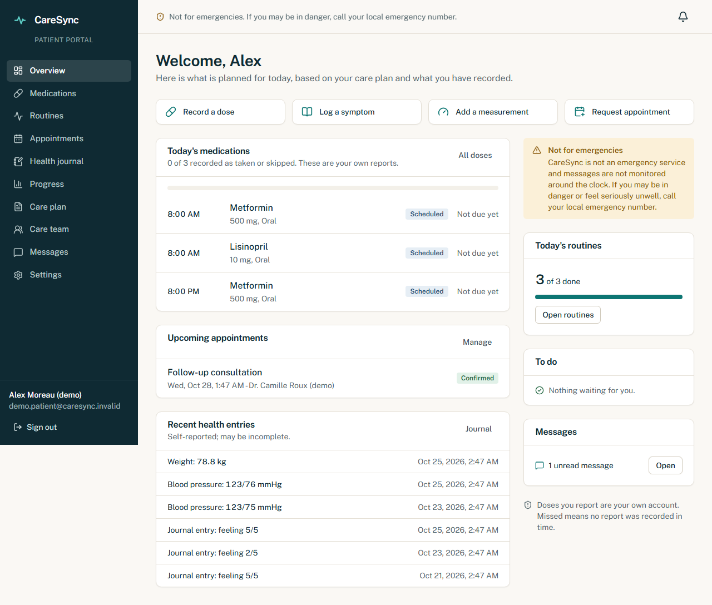

# CareSync

**Connected care. Better everyday health.**

CareSync is a free healthcare coordination web platform for patient medication tracking, daily routines, and authorized clinical follow-up.

> **CareSync is not an emergency service and is not a substitute for professional medical judgment.** If you may be in danger or having a medical emergency, contact your local emergency services. CareSync does not diagnose, prescribe, or change doses.

## Status

Pre-1.0 (`0.1.0`). The core patient, staff and administration workflows are implemented and covered by automated tests. It has **not** had an independent security audit, and it makes **no regulatory compliance claims** (HIPAA, GDPR or otherwise). Read [Known limitations](#known-limitations) and [docs/PRIVACY_AND_SECURITY.md](docs/PRIVACY_AND_SECURITY.md) before using it with real patient data.

## Free for everyone

No subscriptions, no premium tiers, no paid features, no billing system, and no selling of health data. Running an instance still costs money (hosting, database, email, backups); those costs belong to whoever operates it. See [docs/DEPLOYMENT.md](docs/DEPLOYMENT.md).

## Key features

**Patients**
- Medication list with dose, route, schedule and prescriber; record doses as taken or skipped (with actual time and note); dose history. Doses that get no entry become *missed* after a grace period. Entries are labelled as patient-reported.
- Cannot change a clinician-authorized prescription; can send a change request to the care team.
- Daily routines (own and clinician-defined) with streaks and weekly progress.
- Appointments (requested vs. confirmed), cancel/reschedule requests, shared visit notes.
- Health journal (symptoms, well-being, pain) and validated measurements (blood pressure, weight, glucose, heart rate, temperature).
- Progress charts and history tables with an incomplete-data disclaimer.
- Care team view, invitations, connection requests, **per-category consent** (journal, measurements, routines, medication adherence), and removal of a connection.
- Secure messaging with the care team; in-app notifications with preferences and time zone.
- Data export (JSON) and account deletion.

**Medical professionals** (after administrator approval)
- Searchable, paginated patient directory; profiles gated by an active care relationship **and** the patient's consent.
- Versioned care plans with mandatory change reasons, medication schedules, clinician-defined routines.
- Monitoring view: reported dose exceptions, incomplete routines, overdue tasks, new symptom reports, stale records. These are workflow indicators, not diagnoses.
- Appointments, follow-up tasks (assignable), staff-only internal notes, messaging.
- Reports and consent-respecting CSV export.
- Expiring, single-use, email-bound patient invitations.

**Administrators**
- Professional approval, suspension/reactivation, organizations, audit log, platform health, settings. **Administrators cannot read clinical records.**

## Screenshots

Captured from the built app using only the synthetic demo data (fictional people, `.invalid` emails).

| | |
|---|---|
|  |  |
|  |  |

To recapture: `npm run db:seed`, start the app, sign in with the demo accounts, and save images to `docs/screenshots/`. Never capture real patient data.

## Technology

Next.js 15 (App Router) · React 19 · TypeScript (strict) · Tailwind CSS 4 · Lucide icons · Motion (restrained) · Recharts · React Hook Form + Zod · PostgreSQL 16 · Prisma 6 · Vitest · Playwright. Custom server-side sessions (rationale in [docs/ARCHITECTURE.md](docs/ARCHITECTURE.md)).

## Architecture overview

UI (`src/app`, `src/components`) → server actions / REST v1 → **services** (`src/server/services`, all authorization here) → Prisma/PostgreSQL. Pure rules live in `src/domain`. Details: [docs/ARCHITECTURE.md](docs/ARCHITECTURE.md). API: [docs/API.md](docs/API.md).

## Prerequisites

- Node.js 20+ (developed on 22) and npm
- Docker (for the local PostgreSQL), or any PostgreSQL 14+ you point `DATABASE_URL` at

## Setup

```bash
git clone https://github.com/Yasine8710/caresync-healthcare-platform.git
cd caresync-healthcare-platform
npm install
cp .env.example .env          # review the values; see below
npm run db:up                 # PostgreSQL on localhost:5433 via docker compose
npm run db:deploy             # apply migrations
npm run db:seed               # synthetic demo data (optional but recommended)
npm run dev                   # http://localhost:3000
```

### Environment variables

Copy `.env.example` to `.env`. The defaults work for local development with `docker compose`. Variables are documented in [docs/DEPLOYMENT.md](docs/DEPLOYMENT.md). **Never commit `.env`.** Generate real secrets for anything beyond local use (`openssl rand -hex 32`).

### Synthetic demo data

`npm run db:seed` creates one fictional clinician and three fictional patients with 30 days of generated doses, routines, journal entries, measurements, appointments and messages. All emails end in `.invalid`. With `DEMO_MODE=true` the login page offers one-click demo sign-in.

| Role | Email | Password |
|---|---|---|
| Patient | `demo.patient@caresync.invalid` | `DemoPassw0rd!` |
| Clinician | `demo.clinician@caresync.invalid` | `DemoPassw0rd!` |

These public credentials are for synthetic data only. Set `DEMO_MODE=false` and never seed demo data in production.

### Create an administrator

There is no public admin signup:

```bash
ADMIN_EMAIL=you@example.org ADMIN_PASSWORD='a-long-unique-passphrase' npm run admin:create
```

New professional accounts stay in "pending approval" until an administrator approves them in `/admin/approvals`.

### Email in development

No mail transport is bundled. Verification, reset and invitation messages are printed to the server console and the UI says so rather than claiming delivery. See `src/server/mail.ts`.

### Reminders

Run `POST /api/cron/reminders` with `Authorization: Bearer $CRON_SECRET` every ~5 minutes. Locally:

```bash
curl -X POST http://localhost:3000/api/cron/reminders -H "Authorization: Bearer $CRON_SECRET"
```

## Quality commands

```bash
npm run lint           # ESLint
npm run typecheck      # tsc --noEmit
npm test               # unit + integration (uses database caresync_test on the same server)
npm run test:unit
npm run test:integration
npm run test:e2e       # Playwright; run `npm run build` first. Starts the app on E2E_PORT (default 4317), uses the dev database
```

First time with Playwright: `npx playwright install chromium`.

## Production build

```bash
npm run db:deploy && npm run build && npm start
```

Deployment, scheduling, backups: [docs/DEPLOYMENT.md](docs/DEPLOYMENT.md). Security requirements: [docs/PRIVACY_AND_SECURITY.md](docs/PRIVACY_AND_SECURITY.md).

## Security and privacy

Server-side authorization on every operation, relationship- and consent-gated clinical access, hashed single-use invitation tokens, scrypt passwords, revocable hashed sessions, Postgres rate limiting, audit trail without sensitive content, strict security headers. See [docs/PRIVACY_AND_SECURITY.md](docs/PRIVACY_AND_SECURITY.md) and [SECURITY.md](SECURITY.md).

## Known limitations

- No MFA; no bundled email/push transport (console fallback only).
- Messaging is persisted with polling, not real-time sockets.
- Appointment scheduling is request/confirm only (no availability calendar or double-booking prevention).
- Reports cover adherence, routines, symptoms, appointments and tasks at summary level; no PDF export.
- No file uploads. English only.
- Accessibility targets WCAG 2.2 AA but has not been audited by assistive-technology users; see `/accessibility`.
- Not independently security-reviewed or penetration-tested; no legal/regulatory review.
- The `supportEmail` admin setting is stored but not yet displayed; message history shows the latest 50 messages per conversation.
- Dose history exists only for periods the app or the reminder job has materialized (about ±2 days around each visit, plus the cron job).

## Roadmap

1. **0.2** Email transport (SMTP/provider), MFA, richer reports and PDF export.
2. **0.3** Appointment availability and calendar feeds, file attachments with scanning.
3. **0.4** Native mobile clients on REST v1 (refresh tokens, push notifications), localization.
4. **0.5** Organization-level care teams, FHIR import/export exploration.

## Contributing

See [CONTRIBUTING.md](CONTRIBUTING.md) and [CODE_OF_CONDUCT.md](CODE_OF_CONDUCT.md). Report vulnerabilities privately per [SECURITY.md](SECURITY.md).

## License

[Apache License 2.0](LICENSE). Third-party dependencies carry their own permissive licenses (MIT/Apache-2.0/ISC/BSD); run `npx license-checker --summary` to review them for your distribution.

## Disclaimer

CareSync is a coordination and tracking tool. It is **not** an emergency service, does not provide medical advice, diagnosis or treatment, and does not replace the judgment of qualified healthcare professionals.
