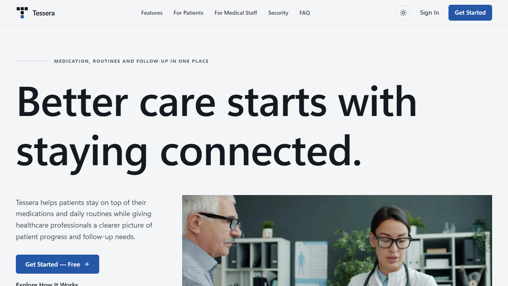
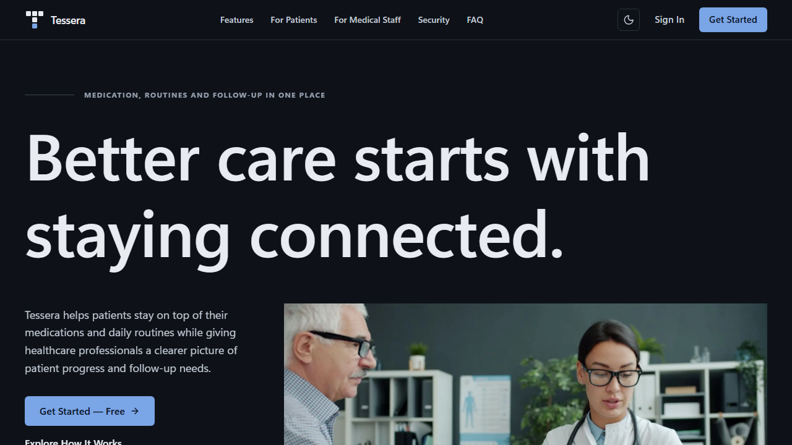
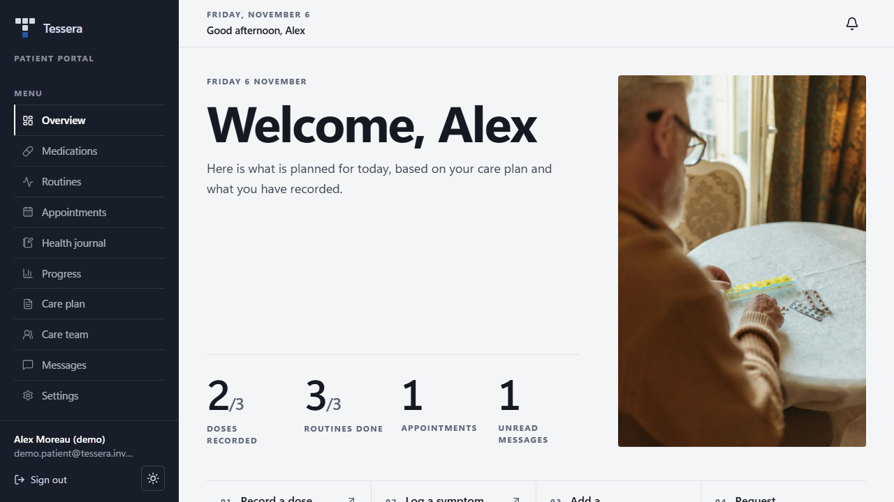
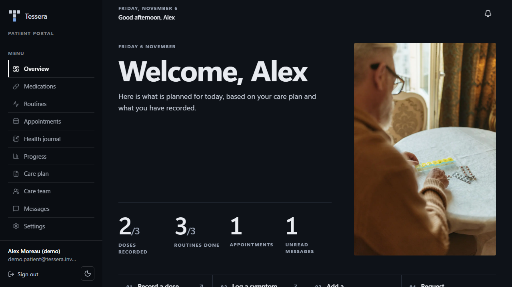
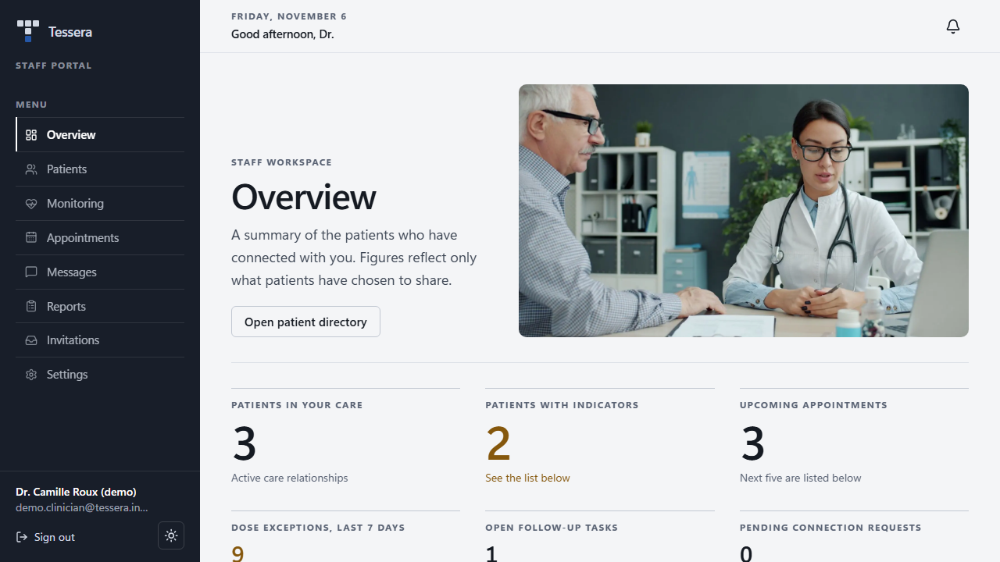
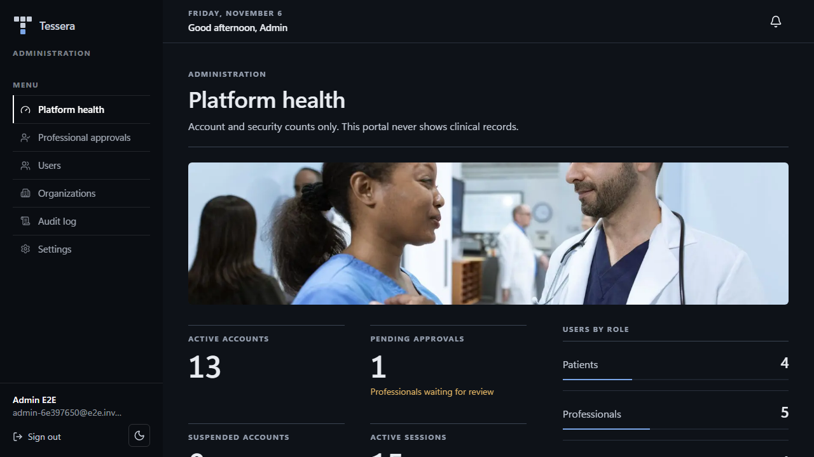

<p align="center">
  
</p>

<h1 align="center">Tessera</h1>

<p align="center"><strong>Connected care. Better everyday health.</strong></p>

<p align="center">
  A Windows desktop app for medication tracking, daily routines and authorised clinical follow-up.<br>
  Local-first, encrypted at rest, for patients, medical professionals and administrators.
</p>

<p align="center">
  
  
  
  
</p>

> **Tessera is not an emergency service and is not a substitute for professional medical judgment.** If you may be in danger or having a medical emergency, contact your local emergency services. Tessera does not diagnose, prescribe, or change doses.

---

## Contents

[What it is](#what-it-is) · [Features](#features) · [Screenshots](#screenshots) · [Install](#install) · [How the desktop app works](#how-the-desktop-app-works) · [Demo accounts](#demo-accounts) · [Design](#design) · [Technology](#technology) · [Architecture](#architecture) · [Development](#development) · [Testing](#testing) · [Security and privacy](#security-and-privacy) · [Known limitations](#known-limitations) · [Roadmap](#roadmap) · [Releases](#releases) · [License](#license)

## What it is

The name comes from *tessera*, a single tile in a mosaic: many small pieces (a dose, a routine, an appointment, a message, a measurement) that only mean something once they sit together. Tessera puts them in one place for three kinds of user:

- **Patients** record what they take and do, and decide exactly which categories of their data a clinician may see.
- **Medical professionals** see only what connected, consenting patients share, and coordinate care plans, appointments, tasks and messages.
- **Administrators** approve professionals and manage accounts. They **cannot** read clinical records.

It runs entirely on one PC. There is no server to host, no database to install and no account to create with a third party.

## Features

**Patients**
- Medication list with dose, route, schedule and prescriber; record doses as taken or skipped (with actual time and note). Doses that get no entry become *missed* after a grace period, and every entry is labelled as patient-reported.
- Cannot change a clinician-authorised prescription; can send a change request to the care team.
- Daily routines (their own and clinician-defined) with streaks and weekly progress.
- Appointments (requested vs. confirmed), cancel and reschedule requests, shared visit notes.
- Health journal (symptoms, well-being, pain) and validated measurements (blood pressure, weight, glucose, heart rate, temperature).
- Progress charts and history tables with an incomplete-data disclaimer.
- Care team view, invitations, connection requests, **per-category consent** (journal, measurements, routines, medication adherence) and removal of a connection at any time.
- Secure messaging with the care team, in-app notifications with preferences and time zone.
- Data export (JSON) and account deletion.

**Medical professionals** (after administrator approval)
- Searchable, paginated patient directory; profiles gated by an active care relationship **and** the patient's consent.
- Versioned care plans with mandatory change reasons, medication schedules and clinician-defined routines.
- Monitoring view: reported dose exceptions, incomplete routines, overdue tasks, new symptom reports and stale records. These are workflow indicators, not diagnoses.
- Appointments, assignable follow-up tasks, staff-only internal notes, messaging.
- Reports and consent-respecting CSV export.
- Expiring, single-use, email-bound patient invitations.

**Administrators**
- Professional approval, suspension and reactivation, organisations, audit log, platform health, settings.
- One-time password-reset links for users (there is no email on a single PC).

**Desktop app**
- Kiosk-style window: animated splash, slim title bar drawn by the app, F11 full screen, themed Windows window controls.
- Light, dark or follow-the-system theme, remembered between launches.
- Windows toast reminders (deliberately generic so nothing clinical shows on a lock screen), tray icon, sign-out after 15 minutes idle and when Windows locks.
- Encrypted backup and restore, recovery-key display, first-run administrator setup.
- Demo accounts for all three roles.

## Screenshots

Captured from the built app with the synthetic demo data only (fictional people, `.invalid` emails). Photographs are free stock images, see [Photo credits](#photo-credits).

| Light | Dark |
|---|---|
|  |  |
|  |  |
|  |  |

## Install

Requirements: Windows 10 or 11 (64-bit). Nothing else.

1. Download `Tessera Setup 0.1.0.exe` from the [latest release](../../releases/latest).
2. Run it. It installs for the current user (no administrator rights) and adds a **Tessera** icon to the desktop and Start menu.
3. Open Tessera. On first run, create the administrator account for that computer.

The installer is **not code-signed**, so Windows SmartScreen may show "unknown publisher": choose **More info**, then **Run anyway**.

## How the desktop app works

- **Engine:** Electron starts the Next.js application in a hidden local process bound to `127.0.0.1` on a random port. Every request must carry a per-launch token, so other programs and browsers on the PC cannot talk to it.
- **Data:** one SQLite file, `%APPDATA%\Tessera\tessera.db`, encrypted with SQLCipher (AES-256). The key is generated on first run and protected with Windows DPAPI, bound to your Windows user. **File, Show recovery key** reveals it; store it offline. Without that key a backup cannot be opened on another PC or Windows account.
- **Backup and restore:** File menu (under the **...** button in the title bar). A copy of the data is kept in `%APPDATA%\Tessera\backups` before every update and every restore.
- **No email:** accounts are verified automatically and administrators create one-time reset links (Administration, Users, Reset password). An administrator who forgot their password uses Help, Reset administrator password.
- **Reminders:** the app checks every 5 minutes while it runs. Closing the window keeps it in the tray; use the tray icon to quit.
- **Window:** opens maximised. F11 toggles full screen. The File and Help items are under the **...** button.
- **Scope:** local only. Several PCs do not share data; one install is one clinic.

## Demo accounts

The sign-in screen (and the first-run screen) has **Demo as patient**, **Demo as medical staff** and **Demo as administrator** buttons with synthetic data: one fictional clinician and three fictional patients with 30 days of generated doses, routines, journal entries, measurements, appointments and messages. The demo administrator is **read-only** and sees demo accounts only. A real administrator can hide the buttons in Administration, Settings. Never enter real personal or health information into a demo account.

## Design

Editorial and clinical: large photography, strong type hierarchy, thin rules, numbered sections and big numerals, using the system font only and one blue accent on neutral surfaces. Light and dark themes are both designed (WCAG 2.2 AA checked in both). Motion explains state (staggered entrances, count-ups, drawn progress rings, photo reveals, sliding indicators) and switches off when Windows has "reduce motion" enabled.

## Technology

Electron 45 · Next.js 15 (App Router) · React 19 · TypeScript (strict) · Tailwind CSS 4 · Motion · Recharts · React Hook Form + Zod · Prisma 6 with the better-sqlite3 driver adapter on the SQLCipher build (`better-sqlite3-multiple-ciphers`) · custom server-side sessions · Vitest · Playwright · electron-builder (NSIS installer).

## Architecture

```
src/app, src/components   UI: pages, server actions, REST v1 for future clients
src/server/services       Business rules; ALL authorisation happens here
src/server                Sessions, audit, mail adapter, security helpers, db client (encrypted)
src/domain                Pure rules and schedule maths (unit tested)
prisma/                   Schema and migrations (SQLite)
desktop/                  Electron main process, preload, splash, migrations runner, key storage
scripts/                  Photos, demo recording, seed and admin bootstrap
tests/, e2e/              Vitest unit/integration, Playwright web and desktop tests
docs/                     API, architecture, deployment, privacy and security
```

Details: [docs/ARCHITECTURE.md](docs/ARCHITECTURE.md). API: [docs/API.md](docs/API.md).

## Development

Requirements: Node.js 20+ (developed on 22) and npm on Windows.

```bash
npm install
cp .env.example .env                 # DATABASE_URL="file:./dev.db"
npx prisma migrate deploy            # create the local SQLite database
npm run dev                          # web build on http://localhost:3000

npm run desktop:prepare              # build the engine the Electron shell runs
npm run desktop                      # run the desktop app from source
npm run desktop:dist                 # build dist-desktop/Tessera Setup <version>.exe
node scripts/record-demo.mjs         # re-record docs/media/tessera-demo.gif (needs ffmpeg)
node scripts/photos.mjs              # re-download and re-encode the bundled photos
```

The Prisma command line cannot open an encrypted database, so the desktop app applies the migration files itself at start-up (`desktop/db.js`), after taking a backup if anything is pending.

## Testing

```bash
npm run lint
npm run typecheck
npm test                                              # 51 unit + integration tests
npm run test:e2e                                      # 38 web tests (run `npm run desktop:prepare` first)
npx playwright test -c playwright.desktop.config.ts   # 12 tests that drive the real Electron app
CS_EXE="path\to\Tessera.exe" npx playwright test -c playwright.desktop.config.ts   # same, against the installed exe
```

The web suite includes WCAG 2.2 AA checks in light and dark themes and a guard against uncaught page errors. Desktop tests cover first-run setup, encryption on disk, foreign-caller rejection, renderer isolation, registration and approval, reset links, demo accounts, backup and restore, the kiosk window and a restart. First time with Playwright: `npx playwright install chromium`.

## Security and privacy

- Server-side authorisation on every operation; relationship- and consent-gated clinical access; administrators never read clinical data.
- Database encrypted at rest (SQLCipher AES-256, key in Windows DPAPI); local engine reachable only with a per-launch token; renderer sandboxed with context isolation and no Node access; every permission request denied.
- Hashed single-use tokens, scrypt passwords, revocable hashed sessions, database-backed rate limiting, audit trail without sensitive content, strict security headers.
- Sign-out when idle and on Windows lock; toasts never contain clinical details.

Tessera has **not** had an independent security audit and makes **no** regulatory compliance claims (HIPAA, GDPR or otherwise). Anyone signed in to your unlocked Windows account can open the app. See [docs/PRIVACY_AND_SECURITY.md](docs/PRIVACY_AND_SECURITY.md) and [SECURITY.md](SECURITY.md).

## Known limitations

- Local only: no sync between computers. No MFA. No email or push transport.
- The installer is unsigned (SmartScreen warning). Windows only.
- Messaging uses polling, not real-time sockets.
- Appointment scheduling is request and confirm only (no availability calendar or double-booking prevention).
- Reports cover adherence, routines, symptoms, appointments and tasks at summary level; no PDF export.
- No file uploads. English only.
- Accessibility targets WCAG 2.2 AA and is checked automatically, but has not been audited by assistive-technology users.
- Dose history exists for the periods the app or the reminder job has materialised (about two days around each visit).

## Roadmap

1. **0.2** Code-signed installer and auto-update, MFA, richer reports and PDF export.
2. **0.3** Appointment availability and calendar feeds, file attachments with scanning.
3. **0.4** Optional encrypted sync between computers, localisation.
4. **0.5** Organisation-level care teams, FHIR import and export exploration.

## Releases

Installers are published under [Releases](../../releases). Version history: [CHANGELOG.md](CHANGELOG.md). Current version: **0.1.0**.

## License

Tessera is **proprietary software. It is not open source.** All rights reserved. No permission to use, copy, modify or distribute it is granted except as written in [LICENSE](LICENSE) or in a separate written agreement. Third-party libraries keep their own licences.

## Disclaimer

Tessera is a coordination and tracking tool. It is **not** an emergency service, does not provide medical advice, diagnosis or treatment, and does not replace the judgment of qualified healthcare professionals.

## Photo credits

Stock photos in `public/photos` come from [Pexels](https://www.pexels.com) under the Pexels licence (free to use, no attribution required). Pexels photo IDs are listed in `src/lib/photos.ts`; `node scripts/photos.mjs` re-downloads and re-encodes them.
